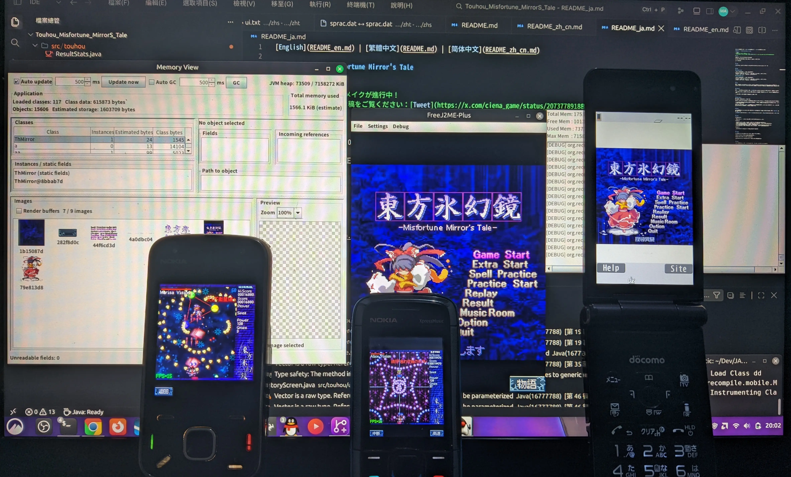

[繁體中文](README.md) | [简体中文](README_zh_cn.md) | [日本語](README_ja.md)

# 東方氷幻鏡 ～ Misfortune Mirror's Tale

> [!NOTE]
> Touhou Hyougenkyou is being remade!
> See Ciena's post on X: [Tweet](https://x.com/ciena_game/status/2073778918889558485)

## Info

Ported from "Touhou Hyougenkyou Plus V1.0.3".

Includes numerous bug fixes and quality-of-life improvements over the original.

---

## Item

See [TODO](https://github.com/Magstic/Touhou_Misfortune_MirrorS_Tale/issues/1).

---

## Play

### Minimum specs

| Item | Recommended |  | Item | Recommended |
|------|------|------|------|------|
| Platform | *MIDP 2.0, CLDC 1.1* |  | CPU & RAM | *≥ 234 MHz*, *JVM ≥ 2.0 MB* |
| Screen | *240 x 240* |  |Optional | *JSR-82, JSR-75*|

### Recommended specs

| Item | Recommended |  | Item | Recommended |
|------|------|------|------|------|
| Platform | *MIDP 2.0, CLDC 1.1* |  | CPU & RAM | *≥ 600 MHz*, *JVM ≥ 4.0 MB* |
| Screen | *240 x 240* |  |Optional | *JSR-82, JSR-75*|

---

### PC

Recommended: customized [**FreeJ2ME-Plus**](https://github.com/Magstic/freej2me-plus/releases/tag/VirtualMIDISynth) + [**Nokia 3110c.dls**](https://musical-artifacts.com/artifacts/828). This may be the closest way to experience Docomo's audio mixing.

---

### Android

[JL-MOD](https://github.com/woesss/JL-Mod/releases) with custom SF2 soundfont support is the top choice.

Of course, I guarantee you won't enjoy playing an STG by tapping glass, let alone the still-garbage mixing on Android even with SF2 lol.

JL-MOD's JSR-82 implementation also has some issues.

---

### Real Device

The game has received numerous optimizations for real devices.

The performance bottleneck is unrelated to heap size: rendering a rain of bullets inevitably consumes most of the CPU's processing power.

The current optimization target is reasonably smooth play on Easy, Normal, and Hard using S60 V3 devices. Some Sony Ericsson models can achieve this too.

S40 V5 benefits from hardware-assisted JVM interpretation. Even with a smaller heap and a weaker CPU, Easy and Normal can be played reasonably smoothly with alpha rendering disabled.

---

## Build

Building this project requires no IDE or SDK installation. The `build.xml` included in the project root handles the entire build.

[中文（繁體）](docs/build.md) | [中文（简体）](docs/build_zh_cn.md) | [English](docs/build_en.md) | [日本語](docs/build_ja.md)

---

## Staff

**Framework**:

- Magstic: framework design, documentation, and limited code review

**Coder**:

- ChatGPT 5.2: 99% of the code cleanup, refactoring, and final review (2026.01)
- Claude 4.6 Opus: English/Japanese translation of Markdown documents and in-game glyph checks (2026.02)
- 5.6 Sol: initial architectural refactoring (2026.08)
- 6.1 Sol: final architectural refactoring and cleanup, logic fixes, and final review (2026.10)
- 6 Astra: English/Japanese translation of Markdown documents and in-game glyph checks (2026.10)

**Support**

- SilentTalk: technical support for builds and performance optimization

---

## Thanks

**L-Garden** & **トッパツプラン** — Created this amazing STG

**Keitai Archive** — Preserved this title

**Fusion Pixel 12Px** — Bitmap font

**Salvation_Jarsis** — Suggested the idea of sharing replays over Bluetooth

---

## About

This project is a MIDP port based on decompiled logic from the original game.

"東方氷幻鏡 ～ Misfortune Mirror's Tale" is a Touhou Project fan game developed by L-Garden & トッパツプラン. Rights in the original game and Touhou Project remain with their respective holders.

If you are affiliated with L-Garden and do not wish for this project to exist, I sincerely apologize and welcome you to contact me anytime via the Email on my [homepage](https://magstic.art/).

---

## License

Port-specific additions are covered by a [custom license](LICENSE).

Source inspection, modification, and personal builds are permitted, but **distribution of this project's game JARs in any form, including modified or repackaged versions, is prohibited**.

The Traditional Chinese license text is authoritative.

Original-game and other third-party content remain subject to their respective licenses. Sources, ownership, and permission status are listed in the [provenance and rights inventory](docs/provenance.md) (Traditional Chinese).
